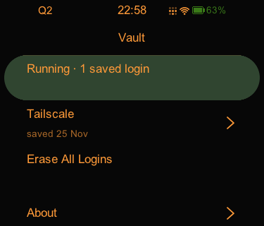
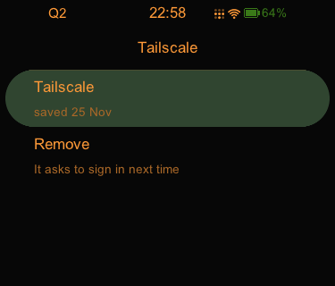
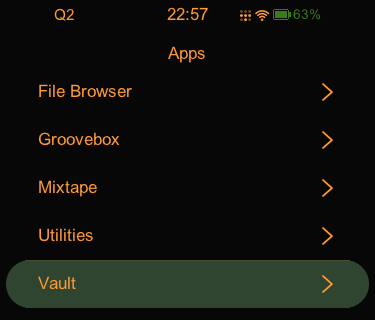
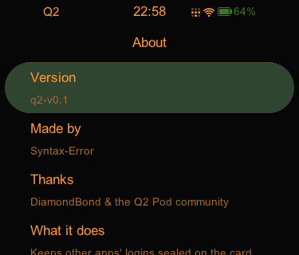

# q2-vault

A card app for the Shanling Q2 running [Q2 Pod](https://github.com/DiamondBond/q2-pod) that keeps other
card apps' logins sealed on the SD card. The one key is in the Q2's internal storage, and each app gets
back only its own login, over a Unix socket. It comes with a small Go package, `vault`, for app makers.

<p>
  
  
</p>
<p>
  
  
</p>

## Apps that use it

- [**Tailscale**](https://github.com/js-surya/q2-tailscale) (q2-v0.8 and later): its HTTPS certificate's
  private keys and its log key go into the Vault, and its working folder moves to RAM, so nothing of it
  but received files stays on the card. Its login stays in the Q2's internal storage.

Your app can too: see [For app makers](#for-app-makers).

## What it does

Card apps keep their logins as plain files on the SD card (a Jellyfin or Plex token, a Deezer cookie,
Subsonic credentials). The card is exFAT, which has no permissions: anyone who reads the card in another
device, uses USB storage, or runs a file manager sees them.

With the Vault, an app that supports it keeps its login sealed (XChaCha20-Poly1305) in
`/.q2vault/<id>.sealed` on the card. The key lives in `/mnt/data/apps/vault`, root only, and never on the
card. A card read anywhere else shows only ciphertext. It is for people who use apps that log in to a
service, and for the makers of those apps. Playback never waits on it: there is no PIN and nothing to unlock.

### How it runs

- **It opens when it is needed.** With `needs=vault` in an app's `q2app`, the firmware starts the Vault
  before the app. That `needs=` key is **planned**: it has been proposed for Q2 Pod and is not in any
  release yet. Until then the Vault starts with Wi-Fi (`wifi=1`), or when you open its row, and apps
  that find no Vault use their own plain file as before.
- **It closes itself only on firmware with `needs=`** (the firmware lists `needs` in
  `/tmp/q2-addon.caps`): 30 seconds after the last app that uses it stops, 60 seconds after you last
  opened its page. That firmware starts it again before the next app that needs it. Apps keep their
  login in memory, so closing signs nothing out, and while an app plays in the background the Vault
  stays. An app that has asked it anything counts as one that uses it until the Vault ends, so an app
  signing in for the first time keeps it open. **On firmware without `needs=` it never closes itself:**
  nothing would start it again for the next app. Wi-Fi going away (its `wifi=1` stop), USB storage and
  shutdown still stop it.
- **Its page** is in Library → Apps → Vault: the apps with a saved login and the date, **Remove** per app
  (it asks to sign in next time) and **Erase All Logins**, which deletes every login and makes a new key,
  for selling or lending the Q2. Both ask first: press twice. Apps already running keep their login in
  memory after Erase All Logins until they stop, and a login one of them saves afterwards is sealed with
  the new key. The page never shows a secret.
- **A removed app's login is deleted** 7 days after the Vault first sees the app missing (a card swap or
  an update moves files briefly, so not at once). The check runs each time the Vault starts. Until then
  the page shows "(not installed)". It never deletes on a clock set before 2026.
- **Updating the Vault** keeps the key and the logins. Removing it while it runs deletes both; removed
  while closed, the key stays, so a reinstall opens the same logins.

## Security

### What it protects

- A card read on a computer, over USB storage, or through a file manager shows no logins, only ciphertext.
- Each app can get only its own login: the request carries no app name; the Vault finds out who asks from
  the kernel (the caller's pid, then `/proc/<pid>/exe`, which must be `/mnt/mmc/.<id>/q2-<id>`).
- A sealed file renamed to another app's id does not open. A file that won't open answers "nothing saved"
  and is kept as `<id>.sealed.bad`, never silently deleted.
- Writes are whole or not at all: a power cut or a pulled card leaves the old login.
- No secret or key is ever logged.

### Limits

- **No hardware key.** The key is in internal storage, readable by root. A root shell or a dump of the
  flash reads it.
- **A malicious app already on the Q2 can race for another app's login:** it connects, keeps the
  connection in a forked child, then runs the other app's binary in its own process, so the Vault sees
  that app. There is no cheap complete fix while all card apps share uid 1000 (the same uid can also read an
  app's memory unless the app sets `prctl(PR_SET_DUMPABLE, 0)`). The Vault protects logins from the card
  being read elsewhere, not from a hostile app on the Q2. Only install apps you trust.
- **Identity is the running binary.** An app that starts another app's real binary under its own control
  (a debugger, or `LD_PRELOAD` for a dynamically linked binary) gets past it. An app that overwrites
  another app's binary on the card would be handed that app's login at its next start.
- **While the Vault isn't running, another app could listen on its socket path.** The client therefore
  refuses a socket not owned by root and sends nothing.
- **Any app can rewrite the Vault's own files on the card** (`.vault/q2-vault`, `run`), which are
  exFAT like the rest of it, and so run as root at the Vault's next start. That is true of every
  `root=1` card app on today's firmware, not only the Vault.
- **Card apps' logins only.** Music, settings and caches are not encrypted, and the firmware's own
  logins (`.scrobble.ini`) are out of scope: they need firmware code.
- **Swapping cards:** the other card's logins stay on that card; on this one, apps sign in again.

## For app makers

The `vault` package is Linux only, uses only the standard library, and can be copied as is (the `vault/`
directory). Elsewhere every call that reaches the socket returns `ErrNotVault`.

```go
secret, err := vault.Get()
```

- `Get() ([]byte, error)`, `Put([]byte) error` (1 byte to 16 KB), `Delete() error` (succeeds whether or
  not one existed).
- With no Vault installed (`/mnt/mmc/.vault/q2-vault` missing) the calls return `ErrNoVault` at once. With
  it installed but not answering, they retry every 250 ms for up to 5 s while its launcher runs
  (`/tmp/q2-vault` names a live pid: it may be starting), then return `ErrNoVault`; with no launcher
  running, `ErrNoVault` at once.
- **`ErrNoVault` while the Vault is installed means "not now"** (it is closed: on firmware without
  `needs=` it starts with Wi-Fi or its row). Keep the plain file, don't move it in, and if it was a
  `Delete` (Sign Out), try the `Delete` again later so no login stays sealed on the card.

| Error | Meaning | What to do |
|---|---|---|
| `ErrNone` | nothing saved | sign in, then `Put` the token |
| `ErrCardAway` | the card is not mounted | keep what you hold in memory; ask again later |
| `ErrNoVault`, `ErrUnavailable` | no Vault, the Vault not running now, or it closed the connection with no answer (temporary) | use your own plain file as before; don't migrate; try the Vault (and a pending `Delete`) again later |
| `ErrNotVault` | something else owns the socket | use your own plain file, warn, and never migrate into it or delete the plain file |
| `ErrRefused`, `ErrTooLarge`, `ErrBadRequest` | a bug, or an app the Vault doesn't know | don't retry |

- **`q2app`:** add `needs=vault` once the firmware supports it (planned). An app works unchanged where no
  Vault is installed.
- **Moving a plain file in:** at start, with a Vault and an old plain login file, `Put` its contents, `Get`
  them back and compare exact bytes with the file, and only then delete the plain file. If anything fails,
  leave the plain file alone.
- **Advice:** keep tokens, not passwords. Sign Out calls `Delete`. Call `prctl(PR_SET_DUMPABLE, 0)` at
  start so other uid 1000 apps can't read the app's memory.

### The protocol: Q2VAULT/1

For apps not written in Go. Connect to `/tmp/q2-vault.sock` (check first that its owner is root). One
request per connection: write the request, shut down your write side, read the answer until it closes.
Lines end in `\n`; a body follows the second line as raw bytes.

```
request:  Q2VAULT/1\n<op>\n[body]
answer:   Q2VAULT/1\n<status>\n[body]
```

| Op | Body | Answer |
|---|---|---|
| `get` | none | `ok` + the secret, or `none` when nothing is saved |
| `put` | the secret, 1 byte to 16 KB | `ok` once sealed and written; `too-large` over 16 KB |
| `delete` | none | `ok`, whether or not one existed |

| Status | Meaning |
|---|---|
| `ok` | done |
| `none` | the app has no saved login |
| `refused` | the caller isn't a card app the Vault can identify |
| `too-large` | over 16 KB |
| `card-away` | the card isn't mounted; the app keeps what it has and asks later |
| `bad-request` | anything malformed |

A connection closed with no answer is a temporary failure: try again later. A connection idle for 5 s is
closed.

## Install

Unzip the [latest release](https://github.com/js-surya/q2-vault/releases/latest)'s
`q2-vault-vX.Y-SHA.zip` at the root of the card (it makes the `.vault` folder), or install it from
**System settings → App Store** once it's listed there. Its row is in **Library → Apps**.

Tested on a Shanling Q2 with Q2 Pod 1.9.3 (Vault started with Wi-Fi) and a 1.9.4 dev build with
`needs=` (started before each app that needs it, closed itself when unused).

## Design

[docs/design.md](docs/design.md): the file format, the keys, the protocol, how the caller is identified,
and the reasons for each choice.

## Build

Needs Go (the version in `go.mod`) and python3:

```sh
sh contrib/shanlingq2/build.sh       # target/shanlingq2/.vault and the release zip
go test ./...
```

The binary is static Go for 32-bit little-endian MIPS (soft float). Put only what `build.sh` produces on
the Q2.

## Credits

- [q2-subsonic](https://github.com/andsuor/q2-subsonic) by andsuor (MIT) and
  [q2-tailscale](https://github.com/js-surya/q2-tailscale) (MIT): the launcher, build and packaging
  scripts and Q2SPOT/1 framing.
- [Q2 Pod](https://github.com/DiamondBond/q2-pod), the firmware this app runs on, by
  [DiamondBond](https://github.com/DiamondBond) and the Q2 Pod community.
- [golang.org/x/crypto](https://pkg.go.dev/golang.org/x/crypto) (BSD-3-Clause) for XChaCha20-Poly1305 and
  BLAKE2b.

## License

MIT. See `LICENSE`.
